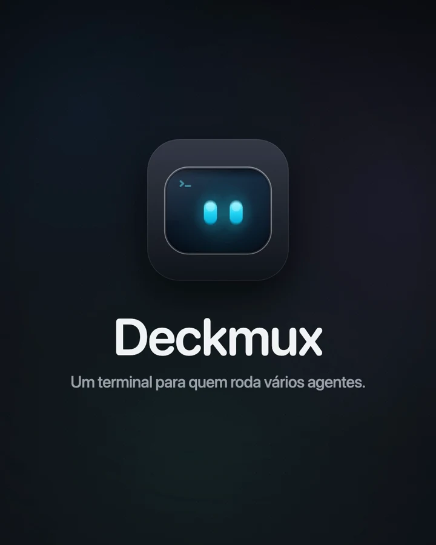

<div align="center">


# Deckmux

**A terminal for people who run many Claude Code agents.**

libghostty terminals organized by workspace, each with its own accounts,<br>
and the state of every agent in sight, without hunting for it.

[](https://github.com/mateusfonsek/deckmux/releases/latest)
[](https://github.com/mateusfonsek/deckmux/actions/workflows/ci.yml)
[](https://github.com/mateusfonsek/homebrew-tap)
[](#install)
[](#install)
[](LICENSE)

[Install](#install) · [Features](#features) · [Getting started](#getting-started) · [Privacy](#privacy) · [Contributing](CONTRIBUTING.md) · [Português](README.md)

<br>

<a href="https://github.com/mateusfonsek/deckmux/releases/latest"></a>

</div>

<br>

<p align="center">
  
</p>

> The interface is in Brazilian Portuguese.

## Install

```bash
brew install --cask mateusfonsek/tap/deckmux
```

<sub>Apple Silicon or Intel · macOS 14 or later · or download the <a href="https://github.com/mateusfonsek/deckmux/releases/latest"><code>.dmg</code> from the latest release</a> · or <a href="#build">build from source</a></sub>

The chats need [Claude Code](https://docs.claude.com/en/docs/claude-code/setup) installed. If it is missing, Deckmux shows how to install it.

## Features

<table>
<tr>
<td width="50%" valign="middle">

### 01 · One workspace per folder

Every folder with a `.workspace.json` becomes a group in the sidebar, with its own name, color, `CLAUDE.md` and MCP servers. A terminal moves to another group by itself when you `cd` into another folder.

The workspace color follows into tabs, meetings and tasks: you can tell which project anything belongs to without reading.

</td>
<td width="50%"></td>
</tr>
<tr>
<td width="50%"></td>
<td width="50%" valign="middle">

### 02 · The right account in every workspace

The same MCP server with different accounts per folder: each company's or client's Google, Slack and ClickUp, connected and checked from a single screen.

Every change goes through a review that shows each file before writing it (`.mcp.json`, `CLAUDE.md`, theme).

</td>
</tr>
<tr>
<td width="50%" valign="middle">

### 03 · Many agents, each one in sight

Deckmux knows when each Claude is working, has finished or is waiting for you, and shows it on the item, the tab, the menu and in notifications. The conversation's name becomes the tab's name.

The integration comes in through hooks passed with `--settings` on every `claude` launch. Nothing is written to your `~/.claude/settings.json`.

</td>
<td width="50%"></td>
</tr>
</table>

### 04 · Code without leaving the terminal

File tree, git changes and a side-by-side diff, opened at the focused terminal's folder. Review what the agent changed without switching apps.

<p align="center"></p>

### 05 · The session comes back whole

Reopen the app and the layout, tabs and splits, folders and every terminal's scrollback come back. Every terminal that was running Claude resumes the same conversation with `claude --resume`.

<p align="center"></p>

<table>
<tr>
<td width="50%" valign="middle">

### 06 · Light for real

Rendering through libghostty and Metal. A hidden terminal stops drawing and, after a while, gives its GPU memory back.

The task manager shows CPU and memory per window, workspace, item and terminal, so you know who is heavy.

</td>
<td width="50%"></td>
</tr>
<tr>
<td width="50%"></td>
<td width="50%" valign="middle">

### 07 · It calls you when it needs you

A face in the menu bar sleeps, works, smiles when it finishes and lights an orange dot when an agent is waiting for you. Its menu lists what needs attention and the next meeting.

</td>
</tr>
</table>

### 08 · And the rest of the day

<table>
<tr>
<td width="50%"></td>
<td width="25%"></td>
<td width="25%"></td>
</tr>
<tr>
<td><b>Hoje</b> (today): the Mac's Calendar agenda, with a button to join Meet, Zoom or Teams, and a task board Claude can use too (<code>deckmux task</code>).</td>
<td><b>Janelinha</b>: sessions, subagents and account usage, floating above everything.</td>
<td><b>Palette</b> (<kbd>⌘</kbd><kbd>⇧</kbd><kbd>P</kbd>): terminals, tasks, meetings and actions.</td>
</tr>
</table>

## Getting started

1. **Workspaces folder.** On first launch, Deckmux asks for the folder where your projects live. Each subfolder with a `.workspace.json` becomes a group; you can create them from the Workspaces tab.
2. **A chat.** The <kbd>✳</kbd> button in the tab bar opens a terminal with Claude already running. The integration works with no setup.
3. **The agenda.** On your first visit to Hoje, a guide shows how to allow calendar access and, if you want, how to connect Google (to the Mac and to Claude). Afterwards it is one click away, on the **?** next to Hoje.

<details>
<summary><b>Agenda and Google, in detail</b></summary>

<br>

Meetings come from the macOS Calendar: any account on the Mac (iCloud, Google, Outlook…) shows up once you allow access.

- **Google on the Mac (optional):** System Settings → Internet Accounts → Add Account → Google, with Calendars on.
- **Google for Claude (optional):** add the Google MCP server to a workspace (Calendar and Drive for Claude), with a Google Cloud OAuth client. The steps are in the app. A workspace with a connected Google account also reads that account's agenda straight from Google's API, with the meeting link guaranteed.
- The Google MCP server runs with [uv](https://docs.astral.sh/uv/) (`uvx`). If it is missing, the form says so and shows how to install it.

</details>

<details>
<summary><b>Installing from the DMG, and the macOS warning</b></summary>

<br>

Download `Deckmux-<version>-universal.dmg` from the [latest release](https://github.com/mateusfonsek/deckmux/releases/latest), open it and drag Deckmux to Applications.

The app is not signed by a registered Apple developer, so when it is downloaded through a browser, macOS blocks the first launch. To allow it, once: open Deckmux, close the warning and go to System Settings → Privacy & Security → **Open Anyway**. Or, in Terminal: `xattr -dr com.apple.quarantine /Applications/Deckmux.app`.

With Homebrew this is not needed: the cask removes the quarantine flag on install. To update: `brew upgrade --cask deckmux`.

Because the signature is ad hoc, macOS may ask again for permissions (Calendars, Accessibility) after you install a new version.

</details>

## Privacy

Deckmux has no account, no server and no telemetry. What it reads and where it goes:

- **The Mac's Calendar:** only with your permission, to show meetings. It stays on the Mac.
- **Google (optional):** if you connect an account in a workspace, the login happens in the browser, directly with Google, and the token is stored in `~/.config/google-workspace-mcp/<workspace>/` with permission 600. The app uses that token to read the agenda from Google's API, and the Google MCP server (Claude Code's) uses the same token.
- **Claude account usage (optional):** with the Janelinha on, the app reads Claude Code's token (its file, or the "Claude Code-credentials" Keychain item) to query the account's usage from Anthropic's API. The token is not stored anywhere else; only the usage numbers are kept, in the session folder.
- **Session:** layout, folders and terminal scrollback stay in `~/Library/Application Support/Deckmux`, on your Mac.
- **Workspace configuration:** the app only writes what you confirm on the review screen, which shows each file first: the workspace's own (`CLAUDE.md`, `.mcp.json`, `.workspace.json`) and, when the change needs it, Claude Code's (`~/.claude/settings.json` to pre-approve MCP servers, `~/.claude.json`, `~/.claude/workspace.md`, themes in `~/.claude/themes`).
- **Claude Code integration in terminals:** the hooks are added only to each `claude` launch, through `--settings`; nothing is written to your configuration.

## Build

Needs Xcode with Swift 6 (the Command Line Tools are enough).

```bash
scripts/build-app.sh release --open        # builds build/app.noindex/Deckmux.app and opens it
swift test                                 # tests
scripts/package-release.sh --universal     # .dmg and .zip like the release, in dist/
```

On the first build, `scripts/ensure-ghosttykit.sh` downloads the prebuilt GhosttyKit (version pinned in `scripts/ghostty.env`) and checks its checksum. To test without touching the Deckmux you use every day, see [CONTRIBUTING.md](CONTRIBUTING.md) (in Portuguese).

## Contributing

Issues and PRs are welcome, in English or Portuguese. [CONTRIBUTING.md](CONTRIBUTING.md) explains how to build, test and how releases ship. Questions go to [Discussions](https://github.com/mateusfonsek/deckmux/discussions); security issues, through [SECURITY.md](SECURITY.md).

## License and credits

[GPL-3.0](LICENSE).

- **[cmux](https://github.com/manaflow-ai/cmux)** (GPL-3.0-or-later, © Manaflow, Inc.): inspiration and technical base. Deckmux reuses code adapted from it and the prebuilt GhosttyKit from the [manaflow-ai/ghostty](https://github.com/manaflow-ai/ghostty) fork.
- **[Ghostty](https://github.com/ghostty-org/ghostty)** (MIT): libghostty and parts of the macOS app.
- **[Bonsplit](https://github.com/manaflow-ai/bonsplit)** and **[Highlightr](https://github.com/raspu/Highlightr)**: vendored in `Packages/`, each with its own license and a `DECKMUX.md` listing what was changed.

<br>

<p align="center"><br><sub>Made for people who spend the day in the terminal.</sub></p>
