<div align="center">


# Deckmux

**Um terminal para quem roda vários agentes do Claude Code.**

Terminais libghostty organizados por workspace, cada um com a sua conta,<br>
e o estado de todos os agentes à vista, sem você procurar.

[](https://github.com/mateusfonsek/deckmux/releases/latest)
[](https://github.com/mateusfonsek/deckmux/actions/workflows/ci.yml)
[](https://github.com/mateusfonsek/homebrew-tap)
[](#instalar)
[](#instalar)
[](LICENSE)

[Instalar](#instalar) · [Recursos](#recursos) · [Primeiros passos](#primeiros-passos) · [Privacidade](#privacidade) · [Contribuir](CONTRIBUTING.md) · [English](README.en.md)

</div>

<br>

<p align="center">
  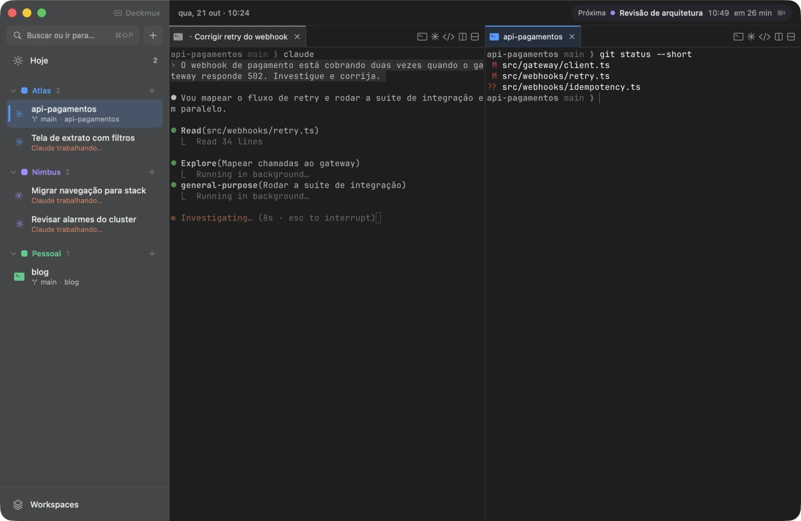
</p>

## Instalar

```bash
brew install --cask mateusfonsek/tap/deckmux
```

<sub>Apple Silicon ou Intel · macOS 14 ou mais novo · ou baixe o <a href="https://github.com/mateusfonsek/deckmux/releases/latest"><code>.dmg</code> da última versão</a> · ou <a href="#compilar">compile do código</a></sub>

Para os chats, o [Claude Code](https://docs.claude.com/en/docs/claude-code/setup) precisa estar instalado. Se não estiver, o Deckmux mostra como instalar.

## Recursos

<table>
<tr>
<td width="50%" valign="middle">

### 01 · Um workspace por pasta

Cada pasta com um `.workspace.json` vira um grupo na barra lateral, com nome, cor, `CLAUDE.md` e MCPs próprios. O terminal muda de grupo sozinho quando você dá `cd` para outra pasta.

A cor do workspace segue para as abas, as reuniões e as tarefas: você sabe de que projeto é cada coisa sem ler.

</td>
<td width="50%">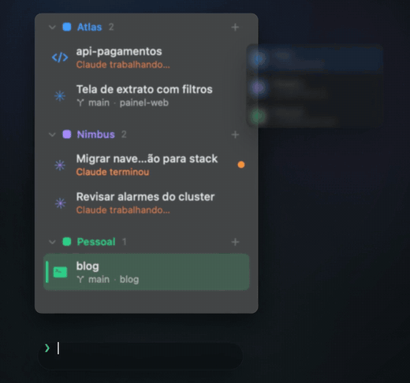</td>
</tr>
<tr>
<td width="50%">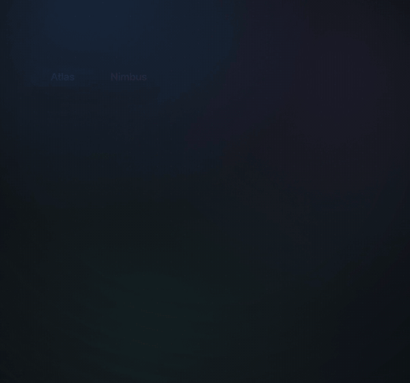</td>
<td width="50%" valign="middle">

### 02 · A conta certa em cada workspace

O mesmo MCP com contas diferentes por pasta: o Google, o Slack e o ClickUp de cada empresa ou cliente, conectados e verificados numa tela só.

Toda mudança passa por uma revisão que mostra cada arquivo antes de gravar (`.mcp.json`, `CLAUDE.md`, tema).

</td>
</tr>
<tr>
<td width="50%" valign="middle">

### 03 · Vários agentes, cada um à vista

O Deckmux sabe quando cada Claude está trabalhando, terminou ou espera você, e mostra isso no item, na aba, no menu e em notificações. O nome da conversa vira o nome da aba.

A integração entra por hooks passados com `--settings` em cada lançamento do `claude`. Nada é gravado no seu `~/.claude/settings.json`.

</td>
<td width="50%">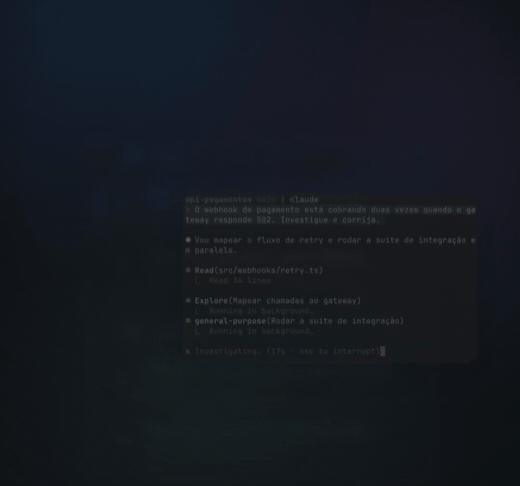</td>
</tr>
</table>

### 04 · Código sem sair do terminal

Árvore de arquivos, alterações do git e diff lado a lado, abertos na pasta do terminal em foco. Revise o que o agente mudou sem trocar de app.

<p align="center">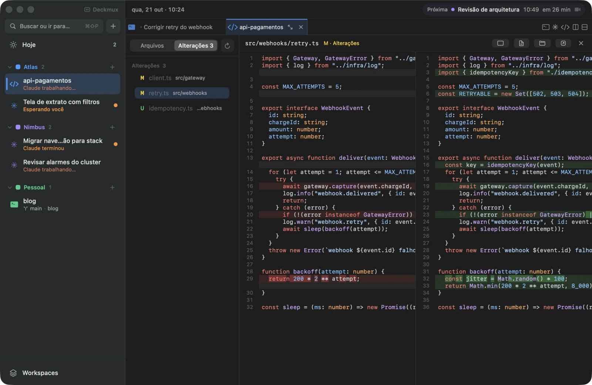</p>

### 05 · A sessão volta inteira

Ao reabrir o app voltam o layout, as abas e os splits, as pastas e o histórico de cada terminal. Cada terminal que rodava o Claude retoma a mesma conversa com `claude --resume`.

<p align="center">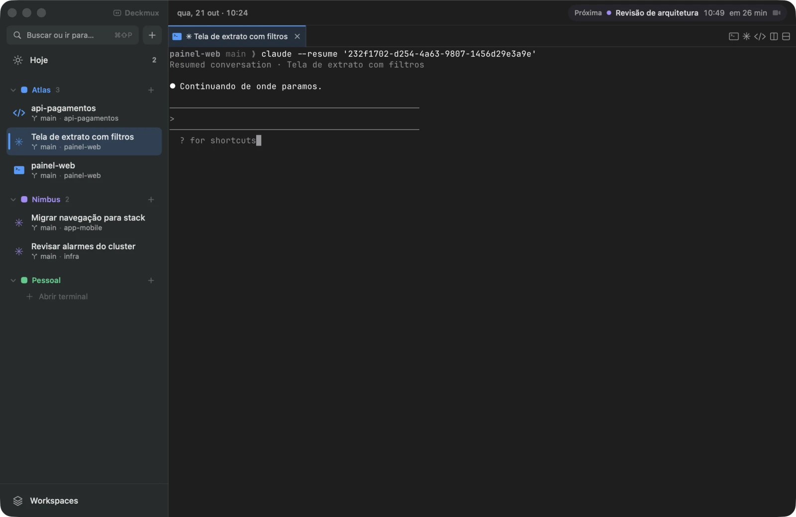</p>

<table>
<tr>
<td width="50%" valign="middle">

### 06 · Leve de verdade

Renderização pela libghostty com Metal. Terminal escondido deixa de desenhar e, depois de um tempo, devolve a memória da GPU.

O gerenciador de tarefas mostra CPU e memória por janela, workspace, item e terminal, para você saber quem está pesando.

</td>
<td width="50%">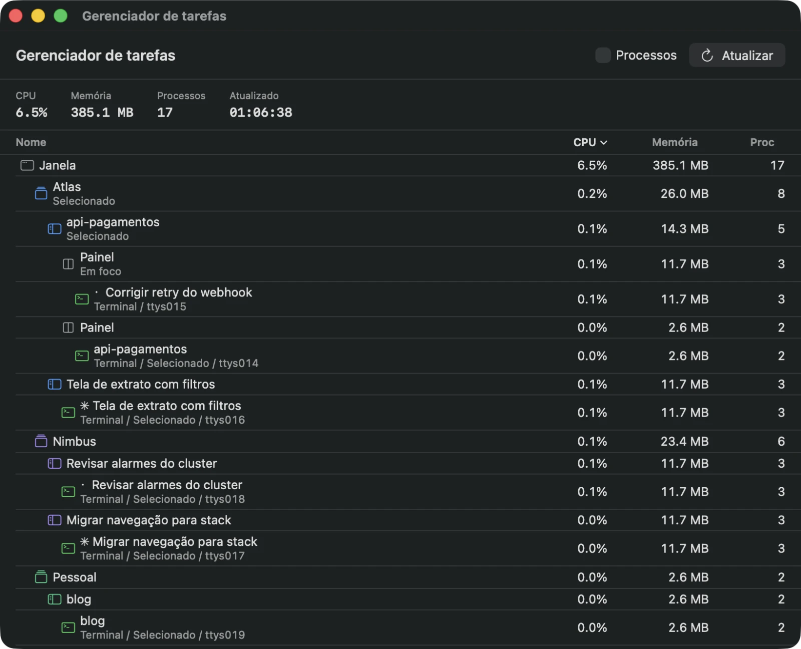</td>
</tr>
<tr>
<td width="50%">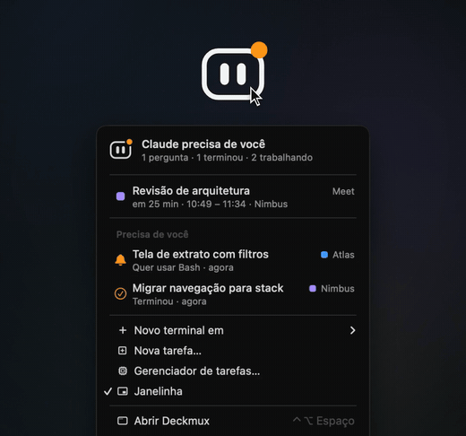</td>
<td width="50%" valign="middle">

### 07 · Ele chama quando precisa de você

Um rosto na barra de menu dorme, trabalha, sorri quando termina e acende o ponto laranja quando um agente espera você. O menu dele lista o que precisa de atenção e a próxima reunião.

</td>
</tr>
</table>

### 08 · E o resto do dia

<table>
<tr>
<td width="50%">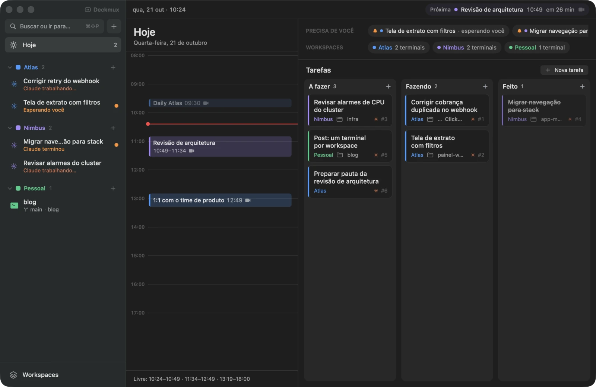</td>
<td width="25%">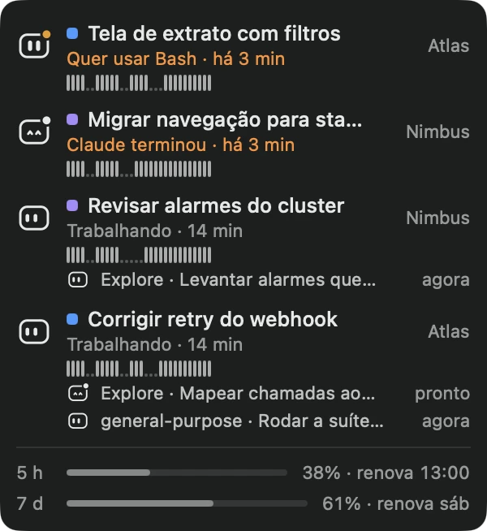</td>
<td width="25%">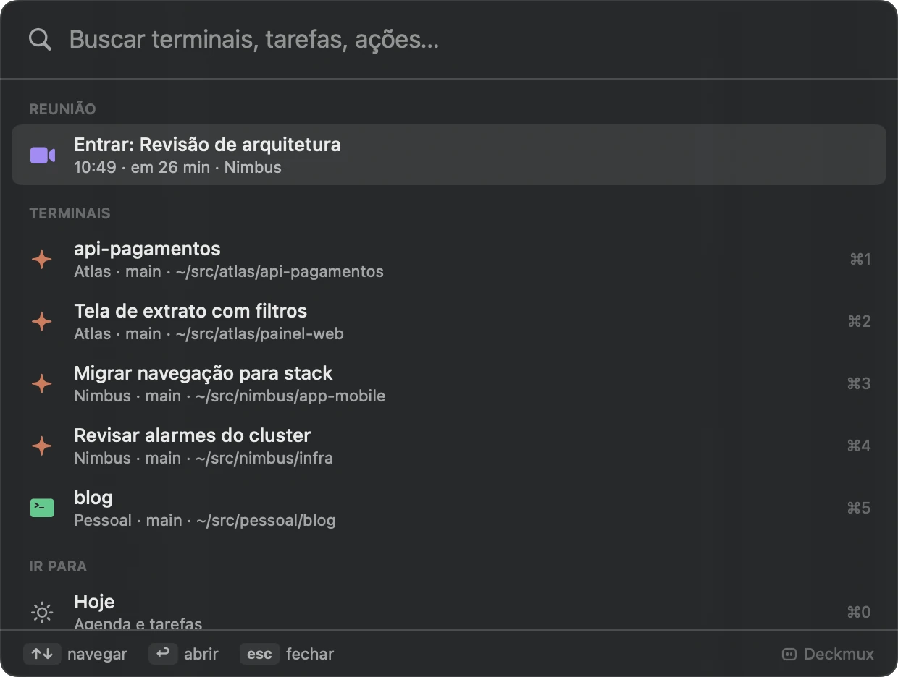</td>
</tr>
<tr>
<td><b>Hoje</b>: a agenda do Calendário do Mac, com o botão para entrar no Meet, Zoom ou Teams, e um quadro de tarefas que o Claude também usa (<code>deckmux task</code>).</td>
<td><b>Janelinha</b>: sessões, subagents e o uso da conta, por cima de tudo.</td>
<td><b>Paleta</b> (<kbd>⌘</kbd><kbd>⇧</kbd><kbd>P</kbd>): terminais, tarefas, reuniões e ações.</td>
</tr>
</table>

## Primeiros passos

1. **Pasta dos workspaces.** Na primeira abertura, o Deckmux pede a pasta onde ficam os seus projetos. Cada subpasta com um `.workspace.json` vira um grupo; dá para criar pela aba Workspaces.
2. **Um chat.** O botão <kbd>✳</kbd> da barra de abas abre um terminal já com o Claude. A integração funciona sem configurar nada.
3. **A agenda.** Na primeira visita à tela Hoje, um guia mostra como permitir o acesso aos calendários e, se quiser, como conectar o Google (ao Mac e ao Claude). Depois, ele volta pelo ícone **?** ao lado de Hoje.

<details>
<summary><b>Agenda e Google, em detalhe</b></summary>

<br>

As reuniões vêm do Calendário do macOS: qualquer conta que estiver no Mac (iCloud, Google, Outlook…) aparece, basta permitir o acesso.

- **Google no Mac (opcional):** Ajustes do Sistema → Contas de Internet → Adicionar Conta → Google, com Calendários ligado.
- **Google no Claude (opcional):** adicione o MCP do Google a um workspace (Agenda e Drive para o Claude), com um cliente OAuth do Google Cloud. O passo a passo está no app. Um workspace com a conta Google conectada também passa a ler a agenda dessa conta direto pela API do Google, com o link da reunião garantido.
- O MCP do Google roda com o [uv](https://docs.astral.sh/uv/) (`uvx`). Se ele faltar, o formulário avisa e mostra como instalar.

</details>

<details>
<summary><b>Instalar pelo DMG e o aviso do macOS</b></summary>

<br>

Baixe o `Deckmux-<versão>-universal.dmg` da [última versão](https://github.com/mateusfonsek/deckmux/releases/latest), abra e arraste o Deckmux para Aplicativos.

O app não é assinado por um desenvolvedor registrado na Apple, então, baixado pelo navegador, o macOS bloqueia a primeira abertura. Para liberar, uma vez só: abra o Deckmux, feche o aviso e vá em Ajustes do Sistema → Privacidade e Segurança → **Abrir Mesmo Assim**. Ou, no Terminal: `xattr -dr com.apple.quarantine /Applications/Deckmux.app`.

Pelo Homebrew isso não é preciso: o cask tira a marca de quarentena na instalação. Para atualizar: `brew upgrade --cask deckmux`.

Como a assinatura é ad-hoc, o macOS pode pedir de novo as permissões (Calendários, Acessibilidade) depois de instalar uma versão nova.

</details>

## Privacidade

O Deckmux não tem conta, servidor nem telemetria. O que ele lê e para onde vai:

- **Calendário do Mac:** só com a sua permissão, para mostrar as reuniões. Fica no Mac.
- **Google (opcional):** se você conectar uma conta num workspace, o login acontece no navegador, direto com o Google, e o token fica em `~/.config/google-workspace-mcp/<workspace>/`, com permissão 600. O app usa esse token para ler a agenda na API do Google, e o MCP do Google (do Claude Code) usa o mesmo token.
- **Uso da conta do Claude (opcional):** com a Janelinha ligada, o app lê o token do Claude Code (o arquivo dele ou o item "Claude Code-credentials" do Keychain) para consultar o uso da conta na API da Anthropic. O token não é gravado em outro lugar; só os números de uso ficam guardados, na pasta da sessão.
- **Sessão:** layout, pastas e o histórico dos terminais ficam em `~/Library/Application Support/Deckmux`, no seu Mac.
- **Configuração dos workspaces:** o app só grava o que você confirma na tela de revisão, que mostra cada arquivo antes: os do workspace (`CLAUDE.md`, `.mcp.json`, `.workspace.json`) e, quando a mudança pede, os do Claude Code (`~/.claude/settings.json` para pré-aprovar MCPs, `~/.claude.json`, `~/.claude/workspace.md`, temas em `~/.claude/themes`).
- **Integração com o Claude Code nos terminais:** os hooks entram só no lançamento de cada `claude`, por `--settings`; nada é gravado na sua configuração.

## Compilar

Precisa do Xcode com Swift 6 (as Command Line Tools bastam).

```bash
scripts/build-app.sh release --open        # monta build/app.noindex/Deckmux.app e abre
swift test                                 # testes
scripts/package-release.sh --universal     # .dmg e .zip como na release, em dist/
```

Na primeira compilação, `scripts/ensure-ghosttykit.sh` baixa o GhosttyKit pré-compilado (versão fixada em `scripts/ghostty.env`) e confere o checksum. Para testar sem mexer no Deckmux que você usa, veja o [CONTRIBUTING.md](CONTRIBUTING.md).

## Contribuir

Issues e PRs são bem-vindos. O [CONTRIBUTING.md](CONTRIBUTING.md) explica como compilar, testar e como as versões saem. Dúvidas vão para as [Discussions](https://github.com/mateusfonsek/deckmux/discussions); falhas de segurança, pelo [SECURITY.md](SECURITY.md).

## Licença e créditos

[GPL-3.0](LICENSE).

- **[cmux](https://github.com/manaflow-ai/cmux)** (GPL-3.0-or-later, © Manaflow, Inc.): inspiração e base técnica. O Deckmux reutiliza código adaptado dele e o GhosttyKit pré-compilado do fork [manaflow-ai/ghostty](https://github.com/manaflow-ai/ghostty).
- **[Ghostty](https://github.com/ghostty-org/ghostty)** (MIT): a libghostty e trechos do app macOS.
- **[Bonsplit](https://github.com/manaflow-ai/bonsplit)** e **[Highlightr](https://github.com/raspu/Highlightr)**: copiados em `Packages/`, cada um com a própria licença e um `DECKMUX.md` com o que foi mudado.

<br>

<p align="center">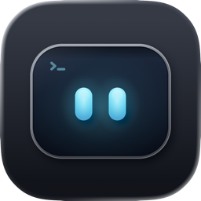<br><sub>Feito para quem passa o dia no terminal.</sub></p>
